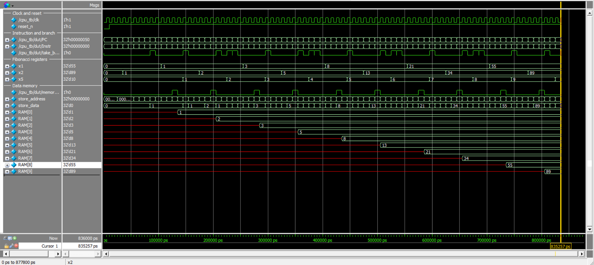

# Single-Cycle RV32I Processor

A 32-bit CPU written in Verilog for the IEEE Digital Design Workshop (2024–2025). The core executes one instruction per clock cycle and uses separate instruction ROM and data RAM. It implements 18 RV32I instructions and is simulated in QuestaSim.

In November 2026, Ali Sabet revisited this team project, corrected several datapath and control edge cases, and added a reproducible QuestaSim test and waveform for the original Fibonacci program.

## Architecture

The program counter addresses the instruction ROM. The control unit decodes the instruction and selects the ALU operands and writeback source. The ALU performs arithmetic and logic, computes load and store addresses, and supplies flags for branch decisions. Each cycle ends with the next PC and any enabled register or RAM write.

- **Register file** — 32 registers with two read ports and one write port. Writes to `x0` are discarded.
- **Instruction memory** — 64 words initialized from [the Fibonacci program](programs/program.txt).
- **Data memory** — 64 words with combinational reads and clocked writes.

## Supported instructions

| Group | Instructions |
| --- | --- |
| Register arithmetic and logic | `ADD`, `SUB`, `AND`, `OR`, `XOR`, `SLL`, `SRL` |
| Immediate arithmetic and logic | `ADDI`, `ANDI`, `ORI`, `XORI`, `SLLI`, `SRLI` |
| Memory | `LW`, `SW` |
| Branch | `BEQ`, `BNE`, `BLT` |

Programs must use this exact subset. An assembler configured for RV32I may emit other instructions. Instruction fetches and word accesses use four-byte-aligned byte addresses from 0 through 252 in their respective memories. An invalid load leaves its destination register unchanged. An invalid store leaves RAM unchanged. A misaligned branch target causes the PC to advance by four.

## Repository layout

| Path | Contents |
| --- | --- |
| [rtl/](rtl/) | `TopModule.v` connects the controller, ALU, register file, memories, immediate extender, and PC logic. |
| [programs/program.txt](programs/program.txt) | Fibonacci program as hexadecimal machine words. |
| [tb/cpu_tb.sv](tb/cpu_tb.sv) | Self-checking Fibonacci smoke test. |
| [do-file/run.do](do-file/run.do) | Questa compile and simulation commands. |

## Run the simulation

Open QuestaSim with the repository root as its working directory and enter:

```tcl
do do-file/run.do
```

The testbench resets the core and runs the Fibonacci program from ROM. It checks that the PC reaches byte address `0x50`, that registers `x1` and `x2` contain `55` and `89`, and that the same values appear at RAM byte addresses `0x20` and `0x24`. A successful run prints `PASS: Fibonacci program`.

## Waveform

The Questa waveform shows the ten Fibonacci values appearing in RAM words 0 through 9. Red traces indicate unknown RAM contents before the first write.



## Authors

- Ali Mohamed
- Abdelrahman Mohamed Misbah ([GitHub](https://github.com/Abdelrahman-Misbah))
